# Student Survey Summary

- Source file: `responses.csv`
- Total responses: **31**
- Percentages are out of the people who answered each question. For checkbox questions,
  people can tick more than one option, so percentages can add up to more than 100%.

## S1. Do you have a smartphone that you can use during class?

Answered by **31** of 31.

| Answer | Count | % |
|---|---:|---:|
| Yes, my own smartphone | 25 | 80.6% |
| Yes, but it is shared with family | 4 | 12.9% |
| No | 2 | 6.5% |

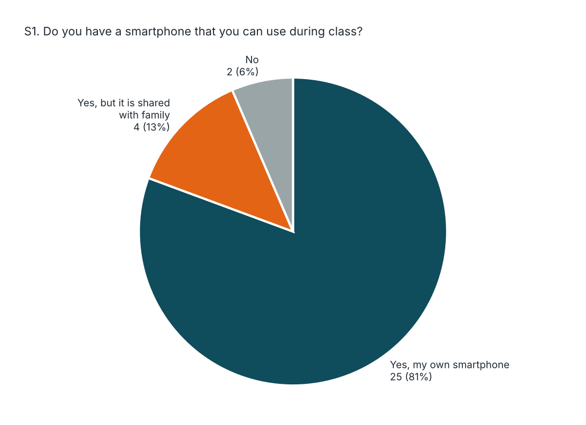

## S2. How is attendance usually taken in your classes?

Answered by **31** of 31.

| Answer | Count | % |
|---|---:|---:|
| Faculty calls out names (roll call) | 21 | 67.7% |
| A paper sheet is passed around | 7 | 22.6% |
| Biometric or ID card machine | 2 | 6.5% |
| An app or QR code | 1 | 3.2% |
| Other | 0 | 0.0% |

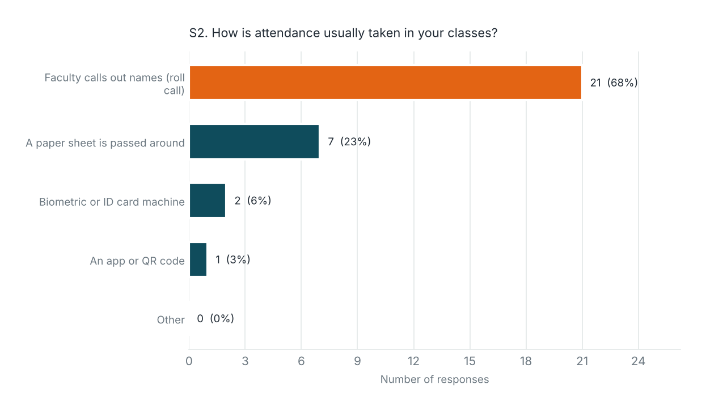

## S3. About how much class time is spent on taking attendance in one lecture?

Answered by **31** of 31.

| Answer | Count | % |
|---|---:|---:|
| Less than 2 minutes | 9 | 29.0% |
| 2 to 5 minutes | 15 | 48.4% |
| 5 to 10 minutes | 5 | 16.1% |
| More than 10 minutes | 2 | 6.5% |

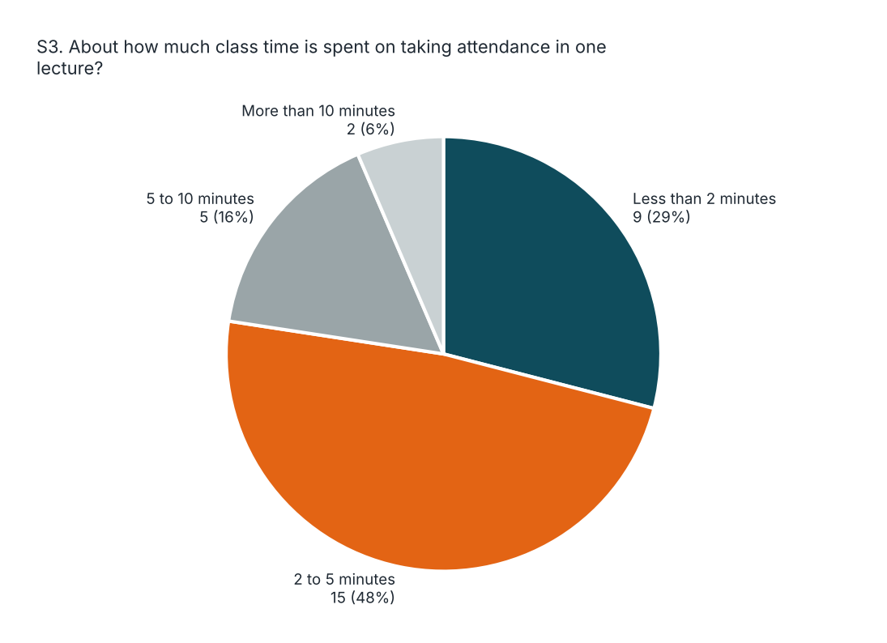

## S4. How often do you notice proxy attendance (someone marking attendance for an absent student) in your classes?

Answered by **31** of 31.

| Rating | Count | % |
|---|---:|---:|
| 1 (Never) | 5 | 16.1% |
| 2 | 5 | 16.1% |
| 3 | 13 | 41.9% |
| 4 | 5 | 16.1% |
| 5 (Very often) | 3 | 9.7% |

- Average rating: **2.87 / 5**
- Rated 4 or 5: **8** (25.8%)

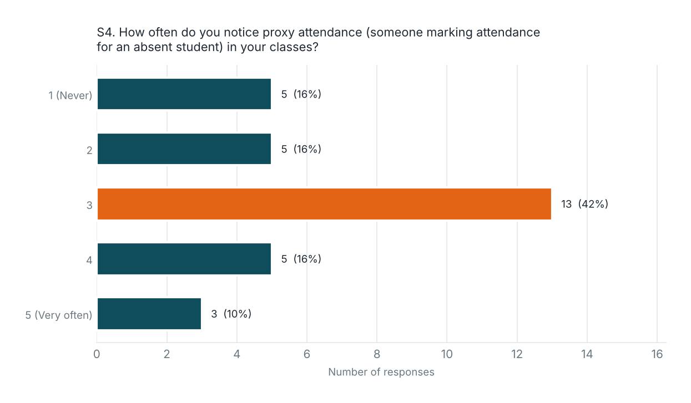

## S5. Do you know your current attendance percentage in each subject?

Answered by **31** of 31.

| Answer | Count | % |
|---|---:|---:|
| Yes, exactly | 14 | 45.2% |
| Only roughly | 11 | 35.5% |
| No | 6 | 19.4% |

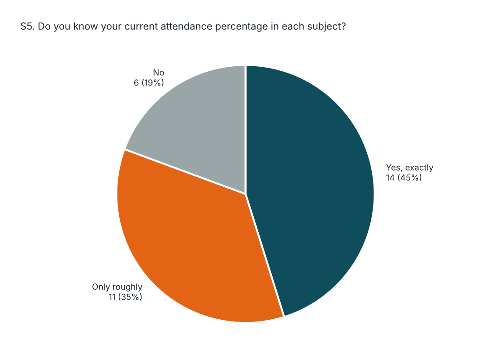

## S6. Have you ever been below or close to the 75% attendance requirement?

Answered by **31** of 31.

| Answer | Count | % |
|---|---:|---:|
| Yes, I was below 75% | 3 | 9.7% |
| Yes, I was close (75% to 80%) | 8 | 25.8% |
| No | 18 | 58.1% |
| I don't know | 2 | 6.5% |

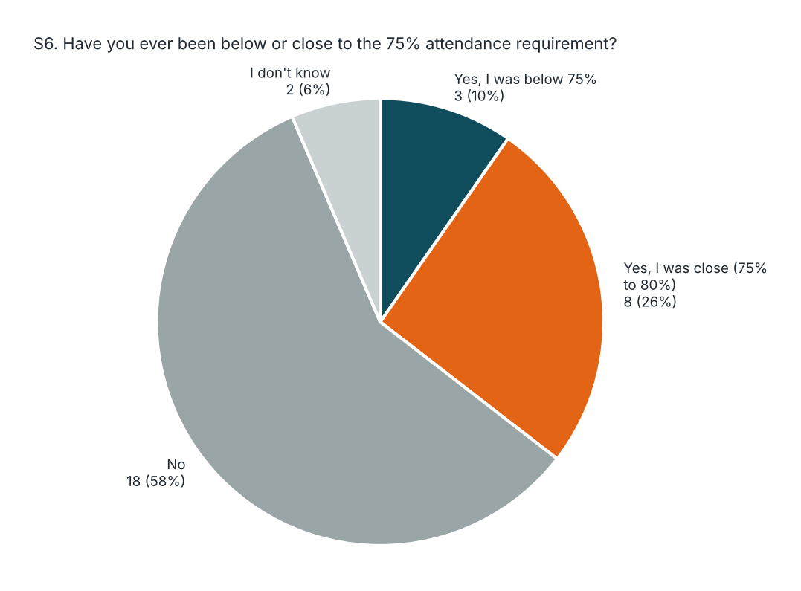

## S7. On a normal day, how many hours do you study outside class?

Answered by **31** of 31.

| Answer | Count | % |
|---|---:|---:|
| Less than 1 hour | 7 | 22.6% |
| 1 to 2 hours | 13 | 41.9% |
| 2 to 4 hours | 8 | 25.8% |
| More than 4 hours | 3 | 9.7% |

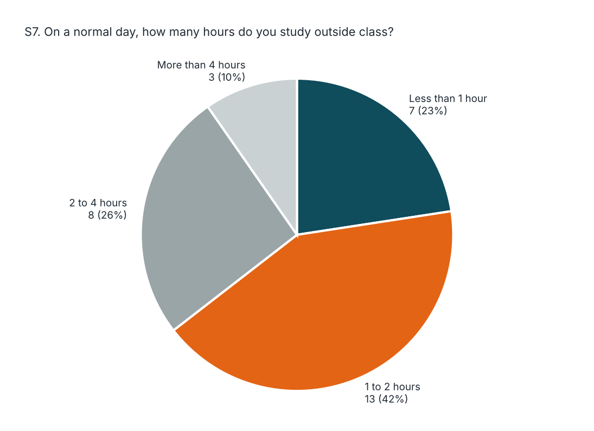

## S8. How do you currently plan or track your study time?

Answered by **31** of 31.

| Option | Count | % |
|---|---:|---:|
| I don't plan or track it | 13 | 41.9% |
| Paper notes or a diary | 8 | 25.8% |
| A to-do list app | 4 | 12.9% |
| A Pomodoro or focus timer app | 2 | 6.5% |
| A calendar or planner app | 3 | 9.7% |
| Other | 2 | 6.5% |

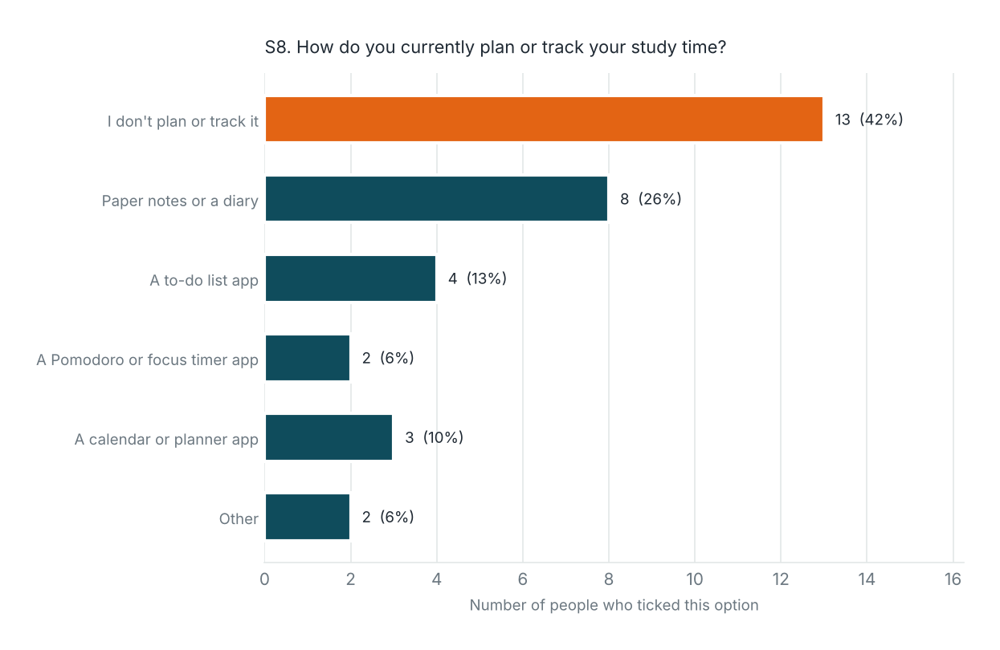

## S9. How hard is it for you to stay focused while studying (for example, because of phone distractions)?

Answered by **31** of 31.

| Rating | Count | % |
|---|---:|---:|
| 1 (Very easy) | 4 | 12.9% |
| 2 | 3 | 9.7% |
| 3 | 11 | 35.5% |
| 4 | 5 | 16.1% |
| 5 (Very hard) | 8 | 25.8% |

- Average rating: **3.32 / 5**
- Rated 4 or 5: **13** (41.9%)

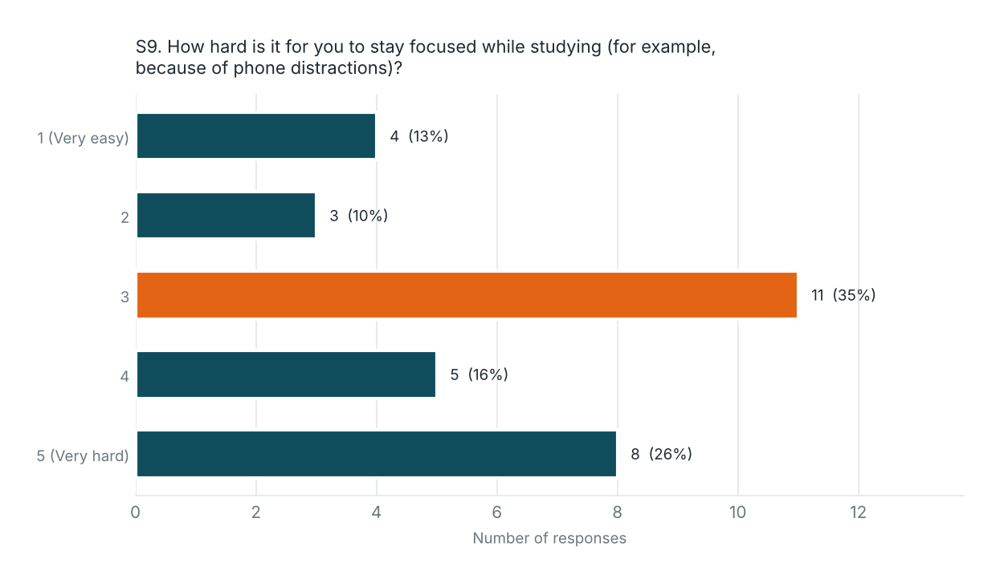

## S10. How comfortable would you be if the app checked your location only at the moment you scan the attendance QR code?

Answered by **31** of 31.

| Rating | Count | % |
|---|---:|---:|
| 1 (Not comfortable at all) | 6 | 19.4% |
| 2 | 2 | 6.5% |
| 3 | 12 | 38.7% |
| 4 | 3 | 9.7% |
| 5 (Very comfortable) | 8 | 25.8% |

- Average rating: **3.16 / 5**
- Rated 4 or 5: **11** (35.5%)

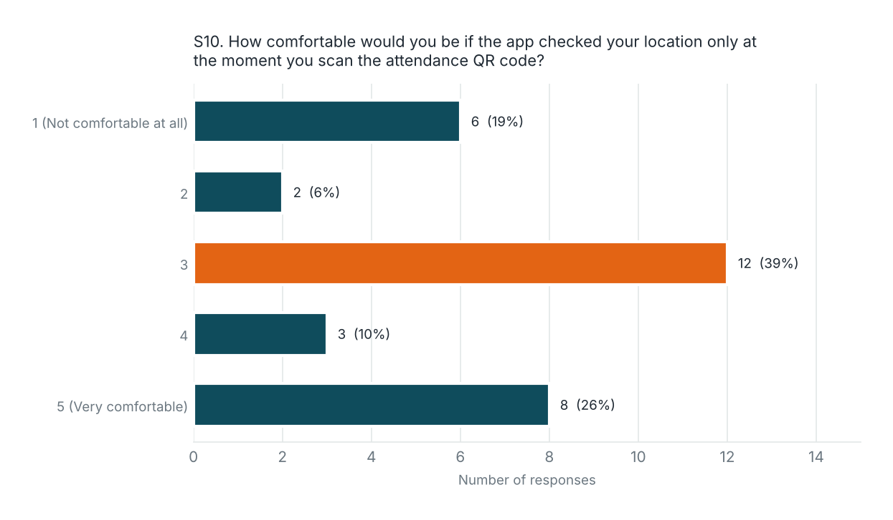

## S11. How interested would you be in one free app that marks attendance by scanning a QR code AND helps you track your study time?

Answered by **31** of 31.

| Rating | Count | % |
|---|---:|---:|
| 1 (Not interested) | 1 | 3.2% |
| 2 | 5 | 16.1% |
| 3 | 17 | 54.8% |
| 4 | 1 | 3.2% |
| 5 (Very interested) | 7 | 22.6% |

- Average rating: **3.26 / 5**
- Rated 4 or 5: **8** (25.8%)

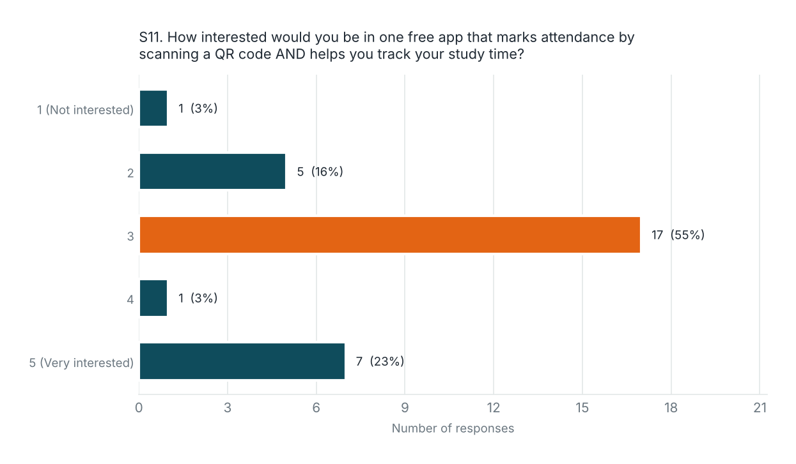

## S12. Which features would matter most to you? (Choose up to 3)

Answered by **31** of 31.

| Option | Count | % |
|---|---:|---:|
| Quick QR attendance | 14 | 45.2% |
| Live attendance % for each subject | 8 | 25.8% |
| Alert when I go below 75% | 13 | 41.9% |
| Pomodoro focus timer | 1 | 3.2% |
| To-do tasks and daily goals | 11 | 35.5% |
| Study time analytics | 7 | 22.6% |
| Other | 0 | 0.0% |

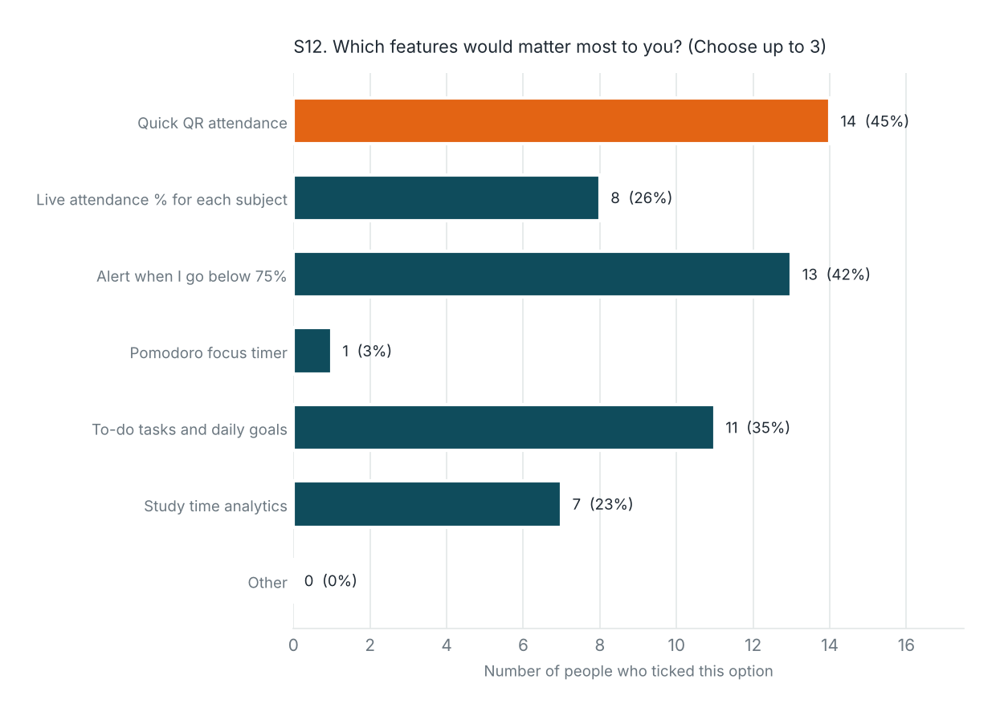
