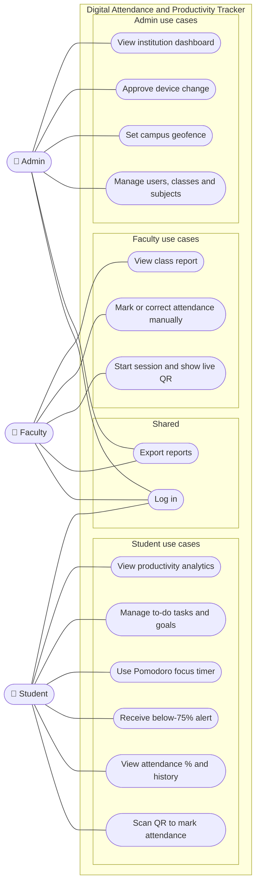
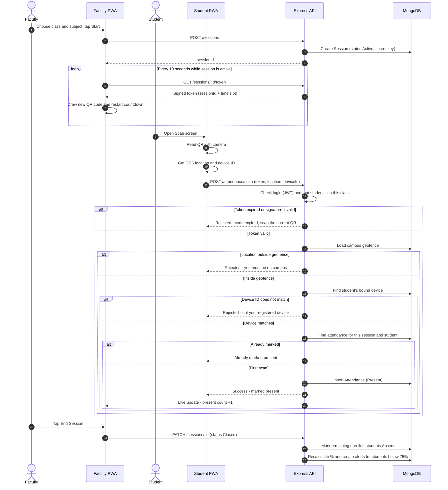
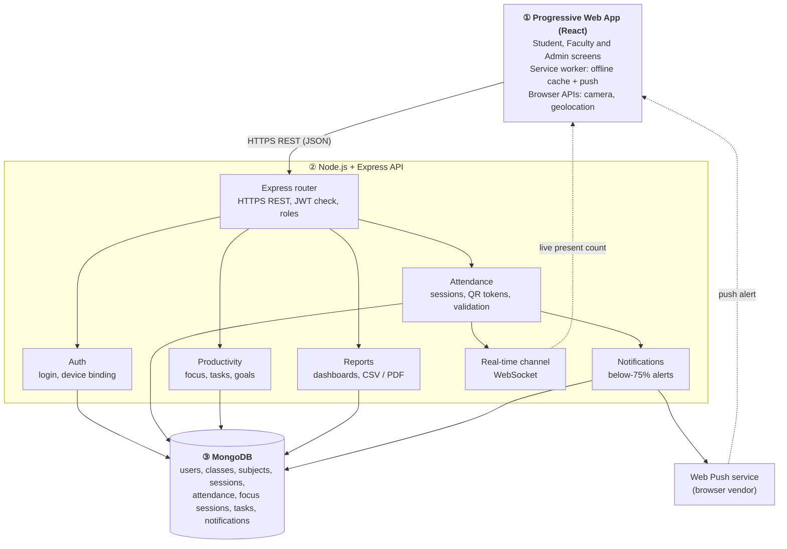
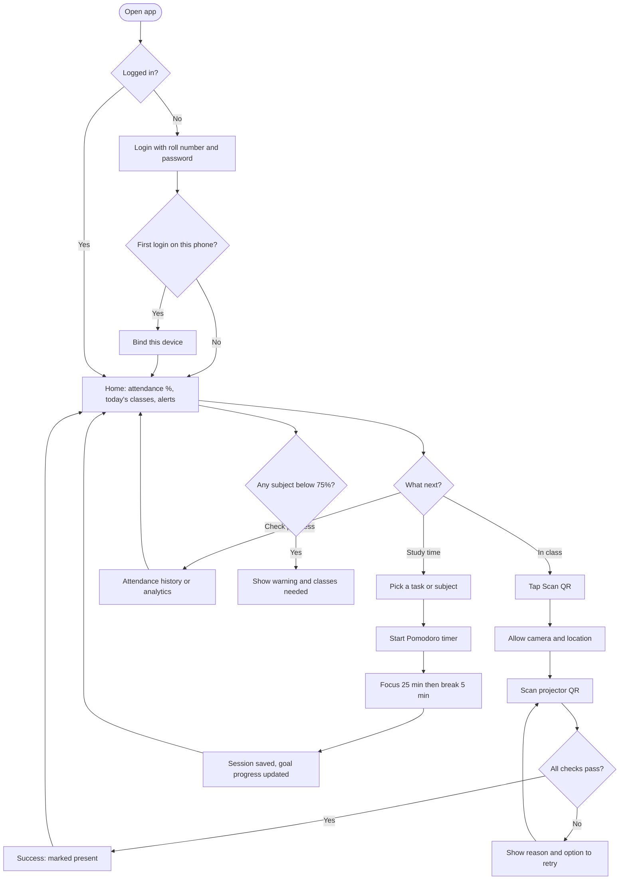
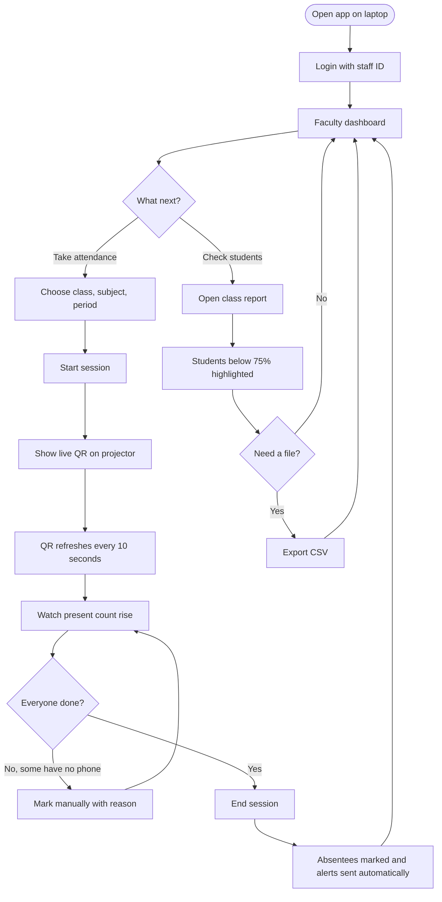
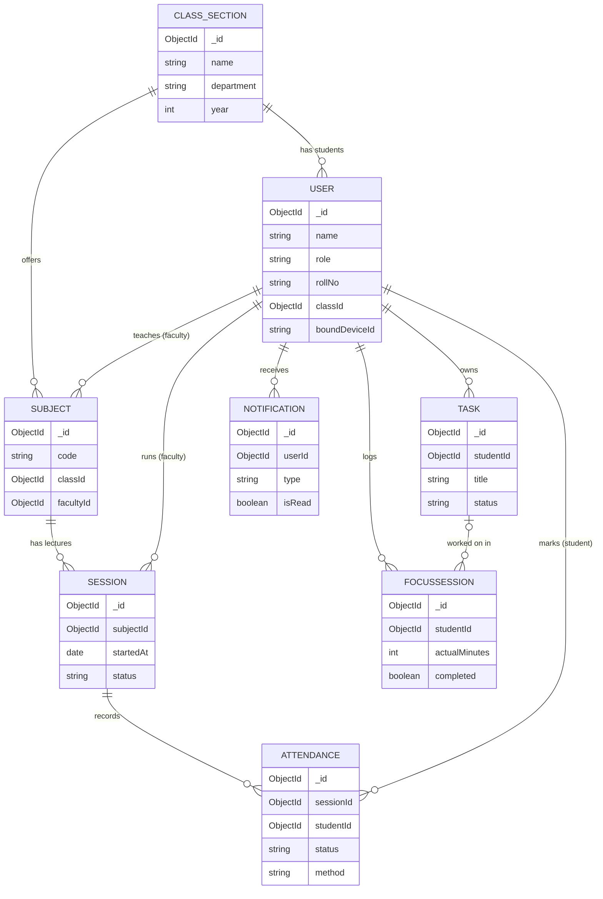

# 04 · Features and System Flow

**Venture:** Digital Attendance and Productivity Tracker for Students
**Platform:** Progressive Web App (PWA) → Express (Node.js) REST API → MongoDB

---

## 1. Feature list (MoSCoW)

**Must** = needed for the first pilot · **Should** = important, add if time allows · **Could** = nice to have later

### Student

| ID | Feature | Description | Priority |
|---|---|---|---|
| ST-1 | Login | Log in with college roll number and password | **Must** |
| ST-2 | Device binding | The first login registers the phone; later scans work only from this device | **Must** |
| ST-3 | Scan QR attendance | Scan the live QR in class to mark attendance in a few seconds | **Must** |
| ST-4 | Live attendance % | See overall and per-subject attendance % at any time | **Must** |
| ST-5 | Below-75% alert | In-app and push alert when any subject drops below 75% | **Must** |
| ST-6 | Attendance history | List of every class with Present / Absent status, filterable by subject | **Must** |
| ST-7 | Pomodoro focus timer | 25-minute focus / 5-minute break timer (adjustable), with the session saved to history | **Must** |
| ST-8 | To-do tasks | Add, edit, complete and delete study tasks, linked to a subject | **Must** |
| ST-9 | Daily study goal | Set a daily focus-minutes goal and see progress | Should |
| ST-10 | Productivity analytics | Charts of focus minutes per day and per subject, plus tasks completed | Should |
| ST-11 | Works offline | The timer and tasks work without internet and sync later | Should |
| ST-12 | "Classes needed" calculator | Shows how many classes must be attended to reach 75% | Could |
| ST-13 | Streaks and badges | Rewards for daily goals met in a row | Could |
| ST-14 | Dark mode | Dark colour theme | Could |

### Faculty

| ID | Feature | Description | Priority |
|---|---|---|---|
| FA-1 | Start session | Choose class, subject and period, then start an attendance session | **Must** |
| FA-2 | Live rotating QR | Full-screen QR for the projector that changes every 10 seconds | **Must** |
| FA-3 | Live present count | Shows the number present out of the class total, updating live | **Must** |
| FA-4 | Manual mark / correction | Mark a student present (e.g., no phone) with a written reason, which is logged | **Must** |
| FA-5 | Class report | Per-student attendance % for a subject; students below 75% highlighted | **Must** |
| FA-6 | Export report (CSV) | Download the class report as CSV / Excel | **Must** |
| FA-7 | Export report (PDF) | Printable PDF report | Should |
| FA-8 | Flagged scans review | See scans that were rejected or look suspicious | Should |
| FA-9 | Notify at-risk students | Send a reminder to all students below 75% | Should |
| FA-10 | Session timetable sync | Auto-suggest the class and subject from the timetable | Could |

### Admin

| ID | Feature | Description | Priority |
|---|---|---|---|
| AD-1 | Manage users | Add, edit and deactivate students and faculty; bulk import from CSV | **Must** |
| AD-2 | Manage classes and subjects | Create classes and subjects and assign faculty | **Must** |
| AD-3 | Campus geofence settings | Set the campus centre point and radius (or several zones) used for scan checks | **Must** |
| AD-4 | Device reset approval | Approve a student's request to change their registered phone | **Must** |
| AD-5 | Institution dashboard | College-wide attendance %, departments at risk, active sessions | Should |
| AD-6 | Institution reports | Export department/semester reports | Should |
| AD-7 | Settings | Change the threshold (75%), QR rotation time and scan time window | Should |
| AD-8 | Audit log | History of manual changes and device resets | Could |
| AD-9 | ERP integration | Sync students and timetable with the college ERP | Could |

---

## 2. User stories for every Must feature

### Student

**ST-1 Login**
*As a student, I want to log in with my roll number and password so that only I can see and mark my attendance.*
- Given a valid roll number and password, when I tap **Login**, then I reach my Home screen.
- Given a wrong password, I see "Invalid roll number or password", and nothing more specific (for security).
- After 5 wrong attempts, login is paused for 5 minutes.
- My session stays logged in on my device until I log out.

**ST-2 Device binding**
*As a student, I want my account linked to my own phone so that nobody else can mark attendance for me from another phone.*
- On my first successful login, the app registers this device and tells me so.
- If I log in on another device, I can view data but **scanning is blocked** and I see "Request device change".
- A device change needs admin approval (AD-4).

**ST-3 Scan QR attendance**
*As a student, I want to scan the QR shown in class so that my attendance is marked in seconds.*
- The app asks for camera and location permission the first time, explaining why.
- Given a valid, unexpired code, inside the campus geofence, on my bound device, with no earlier mark for this session, I see **"Marked present: [Subject], [time]"**.
- If any check fails, I see a clear reason (expired code / outside campus / unregistered device / already marked) and nothing is saved as present.
- The whole scan takes under 5 seconds on a normal 4G connection.

**ST-4 Live attendance %**
*As a student, I want to see my attendance % for each subject so that I always know where I stand.*
- The Home screen shows overall % and per-subject % with "attended / total" classes.
- The numbers update within 1 minute after a session is closed.
- Subjects below 75% are shown with a warning label (not only a colour).

**ST-5 Below-75% alert**
*As a student, I want an alert when I fall below 75% so that I can recover before the shortage list.*
- When a subject's % drops below 75% after a session closes, I get an in-app notification and (if allowed) a push notification.
- The alert names the subject, my current % and how many classes I need to reach 75%.
- I am not alerted again for the same subject until it goes back above 75% and drops again, or a weekly reminder is due.

**ST-6 Attendance history**
*As a student, I want to see my past attendance so that I can check for mistakes.*
- A list shows date, period, subject and status (Present / Absent / Marked by faculty).
- I can filter by subject and month.
- I can tap a record to "Report a problem", which notifies the faculty member.

**ST-7 Pomodoro focus timer**
*As a student, I want a focus timer so that I can study in focused blocks and track my study time.*
- The default is 25 minutes focus and 5 minutes break; I can change it (e.g., 50/10).
- I can link a session to a subject or task before starting.
- Start, pause, resume and stop work; a sound and notification play when time is up.
- A completed focus session is saved with its minutes and subject; a stopped session saves the actual minutes.

**ST-8 To-do tasks**
*As a student, I want a task list so that I can plan what to study.*
- I can add a task with title, subject (optional), due date (optional) and priority.
- I can mark a task done, edit it or delete it.
- Tasks are sorted with overdue first, then by due date.
- I can start a focus timer directly from a task.

### Faculty

**FA-1 Start session**
*As a faculty member, I want to start an attendance session for my class so that students can begin scanning.*
- I can only choose classes and subjects assigned to me.
- Starting a session creates it with status **Active** and opens the Live QR screen.
- I cannot start two active sessions at the same time.

**FA-2 Live rotating QR**
*As a faculty member, I want the QR to change every 10 seconds so that a photo shared on WhatsApp is useless.*
- The QR refreshes every 10 seconds with a visible countdown.
- A code is accepted only within its 10-second window plus a short grace period (e.g., 5 seconds) for slow networks.
- The screen can go full-screen for the projector.
- I can **End session** at any time; after ending, no code is accepted.

**FA-3 Live present count**
*As a faculty member, I want to see how many students have marked present so that I know when to close the session.*
- The screen shows "Present: X / Y" and updates within 2 seconds of each successful scan.
- I can open the list of present and not-yet-marked students.
- The number of rejected scans is shown separately.

**FA-4 Manual mark / correction**
*As a faculty member, I want to mark a student present manually so that genuine cases (no phone, dead battery) are handled fairly.*
- I can mark any enrolled student present for my session, during the session or up to 48 hours after it.
- A reason is required (e.g., "No phone").
- The record is saved as "Marked by faculty" and appears in the audit log.

**FA-5 Class report**
*As a faculty member, I want a report of attendance % per student so that I can identify students at risk.*
- I select class and subject, plus an optional date range.
- Each row shows roll number, name, classes attended / held, and %.
- Rows below 75% are highlighted and labelled "Below 75%".
- I can sort by % or by roll number.

**FA-6 Export report (CSV)**
*As a faculty member, I want to export the report so that I can submit it to the department without retyping.*
- An **Export CSV** button downloads exactly what the report shows.
- The file name includes class, subject and date range.
- The file opens correctly in Excel and Google Sheets.

### Admin

**AD-1 Manage users**
*As an admin, I want to add and manage students and faculty so that the right people can use the system.*
- I can add one user or import many from a CSV (name, roll number / staff ID, email, role, class).
- The import shows which rows failed and why.
- I can deactivate a user; deactivated users cannot log in, but their records are kept.

**AD-2 Manage classes and subjects**
*As an admin, I want to set up classes and subjects so that sessions and reports are organised correctly.*
- I can create a class (department, year, section) and add students to it.
- I can create subjects for a class and assign a faculty member.
- Faculty only see the subjects assigned to them.

**AD-3 Campus geofence settings**
*As an admin, I want to set the campus area so that scans from outside campus are rejected.*
- I can set a centre point (latitude, longitude) and radius in metres, or add more than one zone (e.g., main block and annex).
- I can preview the zone on a map.
- A change applies to new scans immediately and is recorded in the audit log.

**AD-4 Device reset approval**
*As an admin, I want to approve device changes so that students can switch phones without allowing proxy abuse.*
- I see a list of pending device-change requests with the student's name and reason.
- On approval, the old device is unbound and the next login binds the new device.
- A student can have at most one approved change per 30 days (configurable).

---

## 3. Diagrams

### 3.1 Use-case diagram (as a flowchart)

Actors are on the left, and use cases (ovals) are grouped by who mainly uses them. "Log in" and "Export reports" are shared.

### 3.2 QR attendance sequence diagram (with validation checks)

**How the rotating code works:** when a session starts, the server creates a secret key for that session. Every 10 seconds, the faculty screen gets a new token: the session ID plus the current 10-second time slot, signed with the secret. Only the server can create or check these tokens, so an old or edited code is rejected. (This idea is similar to time-based one-time passwords, RFC 6238.)

**Validation order and why:**

| # | Check | What it stops | How |
|---|---|---|---|
| 1 | Login and enrolment | Outsiders, students of other classes | JWT token; student's class must match the session's class |
| 2 | Token expiry and signature | Sharing a photo of the QR, reusing an old code | Token time slot must be the current or previous 10-second slot (small grace period); signature checked with the session secret |
| 3 | Geofence | Scanning from home or the hostel using a forwarded live screen | Distance from campus centre ≤ radius (allowing for the GPS accuracy reported by the phone) |
| 4 | Device check | A friend logging in to your account on their phone | Device ID sent by the app must equal the student's bound device |
| 5 | Duplicate check | Double marking, and rapid retries | Unique database index on (sessionId, studentId) |

Every rejected scan is stored with its reason, so faculty can review it (FA-8).

> **Limits we accept:** GPS can be spoofed on rooted phones, and indoor GPS can be inaccurate. The combination of a 10-second code, geofence and device binding makes proxies much harder, but not impossible. Faculty can still do a quick headcount and compare it with the present count. **[VERIFY]** GPS accuracy inside our classrooms during the pilot.

### 3.3 System architecture

**Technology choices (planned):**

| Layer | Choice | Why |
|---|---|---|
| Frontend | React PWA (installable from the browser) | One codebase for Android, iOS and desktop; no app-store approval needed |
| QR | A QR generator library on the faculty screen; a QR scanner library using the phone camera | Free, works in the browser |
| Backend | Node.js + Express REST API | Simple, popular, team already knows JavaScript |
| Real-time | WebSocket (e.g., Socket.IO) | Live present count on the faculty screen |
| Database | MongoDB | Flexible documents; free tier available for the pilot [VERIFY] |
| Auth | JWT + bcrypt-hashed passwords | Standard and stateless |
| Hosting | Static hosting for the PWA, a small cloud server / PaaS for the API | Low cost for a pilot |

### 3.4 Main user flow: Student

### 3.5 Main user flow: Faculty

---

## 4. Data entities

Main fields only. Every document also has `_id`, `createdAt` and `updatedAt`.

| Entity | Key fields | Notes |
|---|---|---|
| **User** | `name`, `email`, `role` (student / faculty / admin), `rollNo` or `staffId`, `passwordHash`, `department`, `classId` (students only), `boundDeviceId`, `deviceBoundAt`, `dailyGoalMinutes`, `isActive` | One collection for all roles |
| **Class** | `name` (e.g., "CSE-3A"), `department`, `year`, `section`, `semester`, `advisorId` → User | Students link to a class through `User.classId` |
| **Subject** | `code`, `name`, `classId` → Class, `facultyId` → User, `semester` | One subject per class (the same course in two sections = two subjects) |
| **Session** | `subjectId`, `classId`, `facultyId`, `period`, `startedAt`, `endedAt`, `status` (active / closed), `secretKey` (server only, never sent to clients), `rotationSeconds` (10), `presentCount` | One lecture's attendance window |
| **Attendance** | `sessionId`, `studentId`, `subjectId`, `status` (present / absent), `method` (qr / manual / auto-absent), `markedAt`, `location` {lat, lng, accuracy}, `deviceId`, `reason` (manual only), `markedBy` | **Unique index on (sessionId, studentId)**. Rejected scans are logged separately with their reason |
| **FocusSession** | `studentId`, `subjectId` (optional), `taskId` (optional), `type` (focus / break), `plannedMinutes`, `actualMinutes`, `startedAt`, `endedAt`, `completed` | Feeds productivity analytics |
| **Task** | `studentId`, `title`, `subjectId` (optional), `dueDate`, `priority` (low / medium / high), `status` (todo / done), `completedAt`, `pomodorosDone` | Student's own to-do list |
| **Notification** | `userId`, `type` (low_attendance / device_request / system), `title`, `message`, `isRead`, `channel` (in-app / push), `sentAt` | Below-75% alerts, approvals |

*Supporting settings (not one of the 8 main entities):* **CampusSettings**: `zones` [{name, lat, lng, radiusMeters}], `minAttendancePercent` (75), `qrRotationSeconds` (10), `graceSeconds`.

In the diagram below, `CLASS_SECTION` is the **Class** entity (the word `CLASS` is reserved in Mermaid).

**Attendance % formula:** for each student and subject, `% = (sessions marked present ÷ sessions held) × 100`. Only **closed** sessions are counted.

---

## 5. Security and privacy notes

- **Location is checked only at the moment of scanning.** There is no background tracking. We store the scan's location for audit, and **[VERIFY]** how long to keep it (we propose deleting it at the end of the semester).
- **No biometric data** (fingerprint or face) is collected.
- Passwords are stored only as **bcrypt hashes**; all traffic uses **HTTPS**.
- Session secret keys never leave the server; QR tokens expire within seconds.
- Device ID is a random ID created by the app on first login and kept in the browser's storage. It is not a hardware identifier. Clearing browser data means a device-change request is needed.
- Role-based access: students see only their own data; faculty see only their own classes.
- **[VERIFY]** our obligations under India's Digital Personal Data Protection Act, 2023 (consent text, data retention) with our guide before the pilot.

---

## 6. Business model canvas

| Block | Our plan |
|---|---|
| **1. Customer segments** | **Payers:** private engineering, arts & science and autonomous colleges. **Users:** students (free), faculty, college admin. **Beachhead:** our own college, then similar colleges in our district. |
| **2. Value propositions** | **Colleges:** proxy-resistant attendance with no hardware, less faculty time on attendance, instant reports for audits. **Faculty:** attendance in under a minute, automatic reports. **Students:** live attendance %, early alerts, a free focus timer and task planner in one app. |
| **3. Channels** | Direct demo to principal / HODs; a free pilot in one department; word of mouth among faculty; student ambassadors; college tech fests and IQAC meetings; a simple website. |
| **4. Customer relationships** | Onboarding workshop for faculty; WhatsApp/email support; a dedicated contact during the pilot; feedback form in the app; a semester review meeting with the admin. |
| **5. Revenue streams** | Annual **per-student subscription** paid by the college (students always free). Optional one-time setup/onboarding fee. Later: premium analytics add-on or ERP integration fee. Price to be set from interviews with college management. **[VERIFY]** willingness to pay. |
| **6. Key resources** | Our software (PWA + API), cloud hosting and database, the founding team's development skills, pilot data and testimonials. |
| **7. Key activities** | Building and maintaining the app, onboarding colleges, user support, keeping data secure, improving features from feedback. |
| **8. Key partners** | Our college (first pilot site and guide), cloud hosting provider, college IT/admin staff, possibly the college's incubation cell or EDC, and ERP vendors (later) for integration. |
| **9. Cost structure** | Cloud hosting and database, domain, development and maintenance time, onboarding/travel for demos, marketing material. Mostly low fixed costs; costs grow slowly with the number of students. |

---

## 7. Cost estimate: 1-year pilot (INR)

> **All figures below are rough ESTIMATES for planning only.** They are not quotations. Prices of cloud services and domains change, so check each line marked **[VERIFY]** before using these numbers in the final report.
> **Pilot scope assumed:** one college, one or two departments, about 300–600 students.

| Item | What it covers | Low estimate (₹/year) | High estimate (₹/year) |
|---|---|---:|---:|
| Domain name | One `.in` or `.com` domain for a year [VERIFY] | 800 | 1,200 |
| Frontend hosting | Static hosting for the PWA (free tiers exist) [VERIFY] | 0 | 0 |
| API hosting | Free tier at the low end; a small paid server at about ₹1,000/month at the high end [VERIFY] | 0 | 12,000 |
| Database | Free tier at the low end; a small paid tier at about ₹1,000/month at the high end [VERIFY] | 0 | 12,000 |
| SSL certificate | Free certificates (e.g., Let's Encrypt) | 0 | 0 |
| Push notifications | Web Push through browsers (no per-message fee) | 0 | 0 |
| SMS fallback (optional) | Only if the college wants SMS alerts [VERIFY] | 0 | 3,000 |
| Maintenance | Bug fixes and updates. Low: done by our team; high: a part-time student developer at about ₹2,000/month | 0 | 24,000 |
| Testing devices and misc. | Test phones (borrowed / second-hand), mobile data | 2,000 | 5,000 |
| Onboarding material | Printed guides, posters, demo session refreshments | 1,000 | 2,000 |
| **Subtotal** | | **3,800** | **59,200** |
| Contingency (10%) | Unexpected costs | 380 | 5,920 |
| **Total (estimate)** | | **≈ ₹4,180** | **≈ ₹65,120** |

**Illustration only (not a price decision):** if a college paid a hypothetical ₹100 per student per year for 500 students, revenue would be ₹50,000. That covers the low estimate easily. It also covers the high estimate except the paid-maintenance line (₹65,120 − ₹26,400 for maintenance plus its contingency = ₹38,720). The real price must come from talking to college management. **[VERIFY]**
